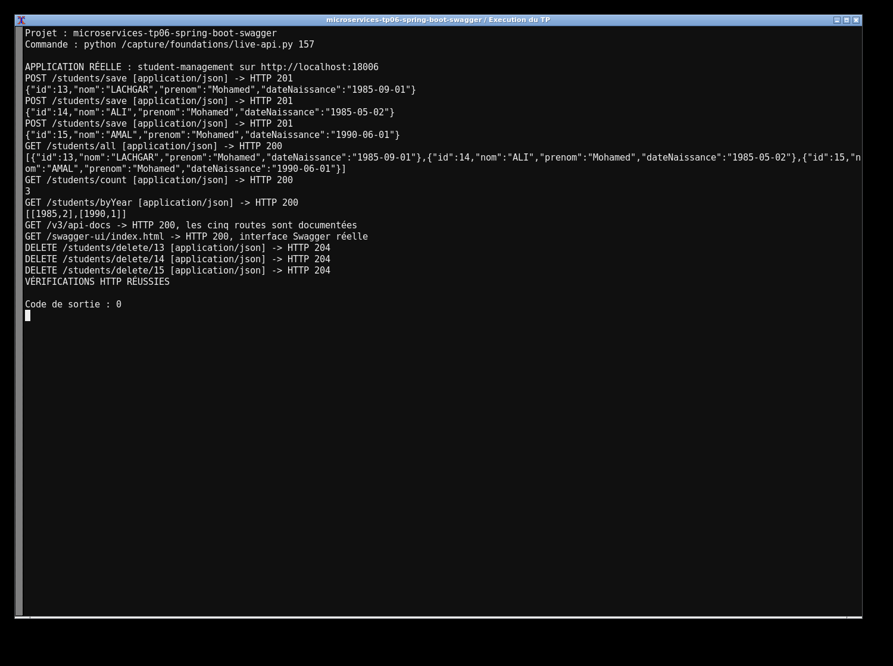
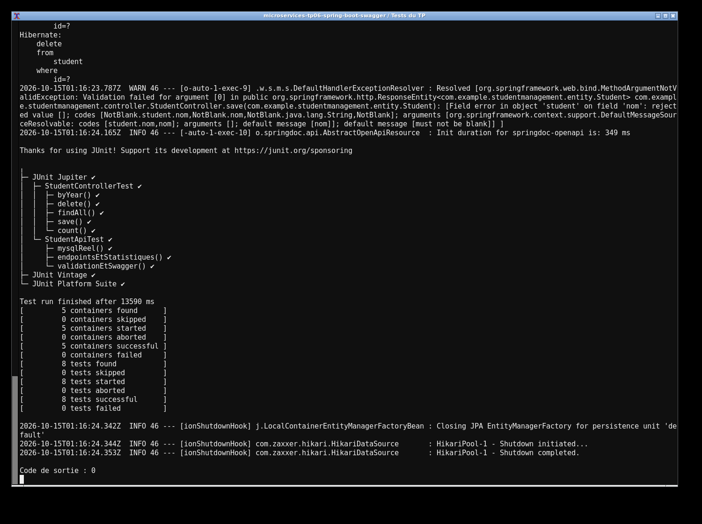

# TP6 — Spring Boot et Swagger

J'ai développé la gestion des étudiants avec Spring Boot, MySQL et Spring Data JPA. `Student`, son repository, le service et le contrôleur sont séparés. Les cinq routes du TP permettent d'ajouter, lister, supprimer, compter les étudiants et regrouper les effectifs par année de naissance.

J'utilise Java 17 et Maven. Pour lancer le projet :

```sh
docker compose up -d --wait
mvn clean verify
mvn spring-boot:run
```

Le serveur écoute sur 18006. Swagger est à `http://localhost:18006/swagger-ui.html`. La base `studentdb` est sur 13317 (`root` / `labroot`), configurable avec `DB_URL`, `DB_USER` et `DB_PASSWORD`. Les dates utilisent `yyyy-MM-dd`. POST `/students/save` renvoie 201 ; DELETE `/students/delete/{id}` renvoie 204 ou 404. Les tests Mockito isolent le contrôleur, et les tests d'intégration utilisent un vrai serveur HTTP et MySQL pour vérifier le CRUD, les statistiques, la validation et OpenAPI.

Les captures montrent l'exécution réelle du projet et des tests sur ma machine.



